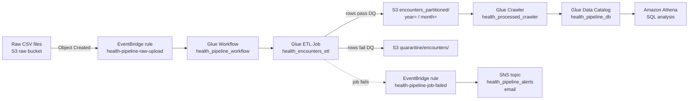
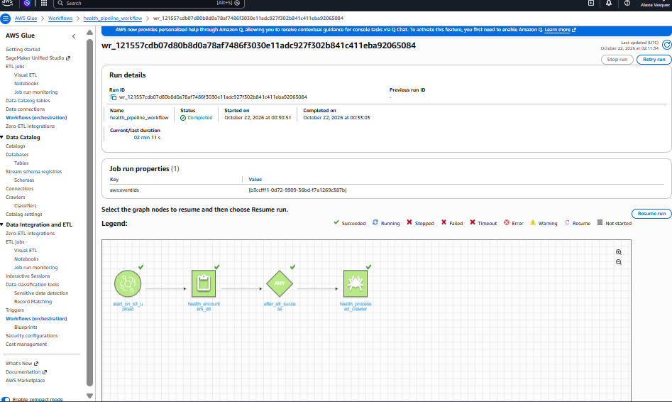

# Health Encounters Data Pipeline on AWS

An end-to-end ETL pipeline that takes raw healthcare encounter data, joins and validates it with AWS Glue, writes clean partitioned Parquet to S3, quarantines bad rows, and makes the data queryable with Amazon Athena. Job failures send an email alert.

I built this project to show hands-on data engineering skills with AWS services. Every step was done by me in the AWS console and in code.

## Architecture

**AWS services used:** S3, Glue ETL, Glue Data Quality, Glue Crawlers, Glue Data Catalog, Athena, EventBridge, SNS

**Region:** us-east-2

## Data

The dataset has 2 sources that are joined in the Glue job, encounter records and patient records. After processing there are 2,000 encounters covering January 2025 through October 2026.

All data is synthetic and was generated for this project. No real patient information is used.

Key fields after enrichment:

| Field | Description |
|---|---|
| encounter_id | Unique ID for each visit |
| patient_id | Links the encounter to a patient |
| encounter_date | Date of the visit |
| encounter_type | Type of visit |
| department | Department that handled the visit |
| provider_id | Provider who saw the patient |
| diagnosis_code / diagnosis_desc | Diagnosis for the visit |
| length_of_stay_days | Days admitted |
| billed_amount / paid_amount | What was billed and what was actually paid |
| readmitted_30d | Y/N flag for a readmission within 30 days |
| birth_year, sex, state, insurance_type | Patient details joined in from the patient table |

## Tables in health_pipeline_db

| Table | Description |
|---|---|
| encounters | Raw encounter data |
| patients | Raw patient data |
| encounters_enriched | Output from the first version of the Glue job, joined but unpartitioned |
| processed_encounters_enriched | Cleaned encounters joined with patient details, unpartitioned |
| processed_encounters_partitioned | Clean output from the Glue job, partitioned by year and month, cataloged by `health_processed_crawler` |

The partitioned output is stored under `encounters_partitioned/year=YYYY/month=M/`. There are 22 partitions, 12 for 2025 and 10 for 2026.

## What the Glue Job Does

The job is `health_encounters_etl`, built in Glue Studio. The full script is in [`glue/health_encounters_etl.py`](glue/health_encounters_etl.py).

1. Reads the raw `encounters` and `patients` tables from the Glue Data Catalog
2. Renames the patient columns to avoid name conflicts, then joins encounters to patients on `patient_id`
3. Fixes data types, for example converting `encounter_date` from string to date
4. Adds `year` and `month` columns from `encounter_date` with Spark SQL
5. Runs 8 Glue Data Quality rules on every row:
   - `encounter_id` is complete
   - `encounter_id` is unique
   - `patient_id` is complete
   - `encounter_date` is complete
   - `billed_amount` is greater than 0
   - `paid_amount` is 0 or greater
   - `length_of_stay_days` is 0 or greater
   - `readmitted_30d` is only Y or N
6. Routes rows by result. Rows that pass go to `encounters_partitioned/`, and rows that fail go to `quarantine/encounters/` for review
7. Drops the data quality result columns from the clean rows
8. Clears the old output folder before writing so reruns do not create duplicates
9. Writes the clean data to S3 as Snappy-compressed Parquet, partitioned by year and month

All 8 rules currently pass on all 2,000 rows.

## Orchestration

The Glue Workflow `health_pipeline_workflow` runs the pipeline as one unit:

**start_on_s3_upload** → **health_encounters_etl** → **after_etl_success** → **health_processed_crawler**

The workflow starts from an EventBridge event when a new file lands in the raw bucket's `encounters/` folder. The crawler only starts after the job succeeds, so Athena never picks up half-written or failed output.

## Alerting

- **EventBridge rule `health-pipeline-job-failed`** watches for the Glue job to fail
- **SNS topic `health_pipeline_alerts`** receives the event and sends an email to my subscribed address

## Validation

| Check | Result |
|---|---|
| Total rows vs. unique encounter IDs | 2,000 and 2,000, so there are no duplicates |
| Nulls in patient_id, birth_year, sex, state, insurance_type | 0 in every column, so every encounter matched a patient |
| Data quality rules | 8 of 8 passed |
| Partitioned vs. unpartitioned March 2026 results | Same answer from both tables, 102 encounters and $4,325.76 average billed |

## Queries

All queries are in the main folder of this repo.

| File | Purpose |
|---|---|
| `01_row_counts.sql` | Confirms no rows were dropped or duplicated during the ETL |
| `02_null_checks.sql` | Checks for missing values in key patient fields after the join |
| `03_monthly_encounters.sql` | Encounter volume by month |
| `04_department_billing.sql` | Average billed vs. paid amounts and percent paid by department |
| `05_readmission_by_insurance.sql` | 30-day readmission rate by insurance type |
| `06_partition_cost_compare.sql` | Compares data scanned on the partitioned and unpartitioned tables |

## Results: Partitioning Cut Data Scanned by About 96%

Athena charges by the amount of data scanned, so partitioning has a direct effect on cost. I ran the same question against both tables, which was how many encounters happened in March 2026 and what the average billed amount was.

| Table | Filter | Data Scanned |
|---|---|---|
| processed_encounters_enriched | `encounter_date BETWEEN '2026-03-01' AND '2026-03-31'` | 26.28 KB |
| processed_encounters_partitioned | `year = '2026' AND month = '3'` | 0.98 KB |

Both queries returned 102 encounters with an average billed amount of $4,325.76. However, the partitioned table only had to read the March 2026 folder instead of the whole dataset. At this sample size the cost is the same in dollars, since Athena bills a 10 MB minimum per query, but the same pattern on a production dataset with years of history would cut query costs significantly.

## Design Choices

- **Parquet with Snappy compression.** Columnar storage means Athena only reads the columns a query uses, which lowers cost and speeds up queries.
- **Partitioning by year and month.** Most healthcare reporting is by month, so this matches how the data is actually queried.
- **Quarantine instead of dropping bad rows.** Failed rows are kept in their own folder so they can be reviewed and fixed. Nothing is silently lost.
- **Clearing the output before each run.** This makes the job safe to rerun without doubling the data. Only the clean output is cleared. Quarantined rows are kept across runs for review.
- **Crawler after the job.** New partitions are picked up automatically so Athena always sees the latest data.
- **Failure alerts.** I get an email if the job fails instead of finding out later from bad numbers.

## Key Findings

- **Pulmonology has the highest average billed amount** at $3,356.97 per encounter.
- **Emergency Medicine has the most volume** with 487 encounters, about 1 in 4 of all visits. That is almost double the next department, Behavioral Health, at 267.
- **Payers paid between 61% and 66% of billed amounts** across the top 5 departments by average billed.
- **Commercial insurance has the highest 30-day readmission rate** at 1.9%. Medicare and TRICARE are the lowest at 0.9%.
- **Monthly volume is steady** at 81 to 109 encounters per full month. October 2026 shows 55 because the data ends partway through that month.

## Project Status

- [x] Test safe reruns: reran the job, the row count stayed at 2,000 and the year/month partitions were rebuilt
- [x] Glue Workflow that runs the job, then the crawler, tested with a full run that returned 2,000 of 2,000 rows
- [x] S3 trigger so a new file in the raw `encounters/` folder starts the workflow, using EventBridge rule `health-pipeline-raw-upload`
- [x] End-to-end test: uploading the file to S3 started the workflow automatically, and Athena returned 2,000 rows
- [ ] Infrastructure as code with CloudFormation or Terraform

## Screenshots

**Validation**

**Analysis**

**Partitioned data in S3**

**Partition cost comparison**

This project shows the full path from raw files to clean, validated, cost-optimized data on AWS.
