# aws-health-encounters-etl
End-to-end AWS ETL pipeline for healthcare encounter data. Glue + S3 + Athena, with year/month partitioning (96% less data scanned), 8 data quality rules with a quarantine path, safe reruns with no duplicate rows, and failure alerts.

# Health Encounters Data Pipeline on AWS

An end-to-end ETL pipeline that takes raw healthcare encounter data, cleans and enriches it with AWS Glue, stores it in S3 as partitioned tables, and makes it queryable with Amazon Athena.

I built this project to show hands-on data engineering skills with AWS services. Every step was done by me in the AWS console and in code. Health centric. 

## Architecture

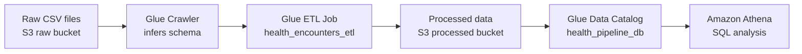

**AWS services used:** S3, Glue Crawlers, Glue ETL, Glue Data Catalog, Athena
**Region:** us-east-2

## Data

The dataset has 2 sources that are joined in the Glue job, encounter records and patient records. After processing there are 2,000 encounters covering January 2025 through October 2026.

 This is a synthetic dataset, generated to show the realm of the job positions scope. 
Key fields after enrichment:

| Field | Description |
|---|---|
| encounter_id | Unique ID for each visit |
| patient_id | Links the encounter to a patient |
| encounter_date | Date of the visit |
| encounter_type | Type of visit |
| department | Department that handled the visit |
| provider_id | Provider who saw the patient |
| diagnosis_code / diagnosis_desc | Diagnosis for the visit |
| length_of_stay_days | Days admitted |
| billed_amount / paid_amount | What was billed and what was actually paid |
| readmitted_30d | Y/N flag for a readmission within 30 days |
| birth_year, sex, state, insurance_type | Patient details joined in from the patient table |

## Tables in health_pipeline_db

| Table | Description |
|---|---|
| encounters | Raw encounter data cataloged by the crawler |
| patients | Raw patient data cataloged by the crawler |
| encounters_enriched | [PLACEHOLDER: describe this table, for example an intermediate output of the join] |
| processed_encounters_enriched | Cleaned encounters joined with patient details |
| processed_encounters_partitioned | Same data, partitioned by year and month |

The partitioned table is stored in S3 under `encounters_partitioned/year=YYYY/month=M/`, with 12 month folders for 2025 and 10 for 2026.

## What the Glue Job Does

[PLACEHOLDER: fill in the actual steps from your Glue script. Typical steps would be the ones below, delete any that do not apply]

1. Reads the raw encounter and patient tables from the Data Catalog
2. Cleans the data by fixing data types and handling missing values
3. Joins encounters to patients on patient_id
4. Writes the enriched output to S3 as Parquet
5. Writes a second copy partitioned by year and month

## Validation

| Check | Result |
|---|---|
| Total rows vs. unique encounter IDs | 2,000 and 2,000, so there are no duplicates |
| Nulls in patient_id, birth_year, sex, state, insurance_type | 0 in every column, so every encounter matched a patient |
| Partitioned vs. unpartitioned March 2026 results | Same answer from both tables, 102 encounters and $4,325.76 average billed |

## Queries

All queries are in the [`athena_queries`](athena_queries/) folder.

| File | Purpose |
|---|---|
| `01_row_counts.sql` | Confirms no rows were dropped or duplicated during the ETL |
| `02_null_checks.sql` | Checks for missing values in key patient fields after the join |
| `03_monthly_encounters.sql` | Encounter volume by month |
| `04_department_billing.sql` | Average billed vs. paid amounts and percent paid by department |
| `05_readmission_by_insurance.sql` | 30-day readmission rate by insurance type |
| `06_partition_cost_compare.sql` | Compares data scanned on the partitioned and unpartitioned tables |

## Results: Partitioning Reduced Data Scanned by About 27x

Athena charges by the amount of data scanned, so partitioning has a direct effect on cost. I ran the same question against both tables, which was how many encounters happened in March 2026 and what the average billed amount was.

| Table | Filter | Data Scanned |
|---|---|---|
| processed_encounters_enriched | `encounter_date BETWEEN '2026-03-01' AND '2026-03-31'` | 26.28 KB |
| processed_encounters_partitioned | `year = '2026' AND month = '3'` | 0.98 KB |

Both queries returned 102 encounters with an average billed amount of $4,325.76. However, the partitioned table only had to read the March 2026 folder instead of the whole dataset. At this sample size the savings are small in dollars, but the same pattern on a production dataset with years of history would cut query costs significantly.

## Key Findings

- **Pulmonology has the highest average billed amount** at $3,356.97 per encounter.
- **Emergency Medicine has the most volume** with 487 encounters, about 1 in 4 of all visits. [PLACEHOLDER: confirm the 2 departments not shown in the screenshot have fewer than 487]
- **Payers paid between 61% and 66% of billed amounts** across the top 5 departments by average billed.
- **Commercial insurance has the highest 30-day readmission rate** at 1.9%. Medicare and TRICARE are the lowest at 0.9%.
- **Monthly volume is steady** at roughly 80 to 110 encounters per month. [PLACEHOLDER: confirm against all 22 months, only the first 8 are in the screenshot]

## What I Would Add Next

- Schedule the Glue job with a trigger so new data is processed automatically
- Add data quality rules with Glue Data Quality
- Build a dashboard in QuickSight on top of the Athena tables

[PLACEHOLDER: edit this list to match what you actually plan to add]

## Screenshots

**Validation**

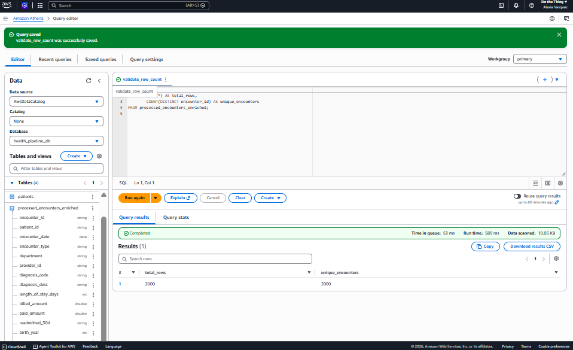
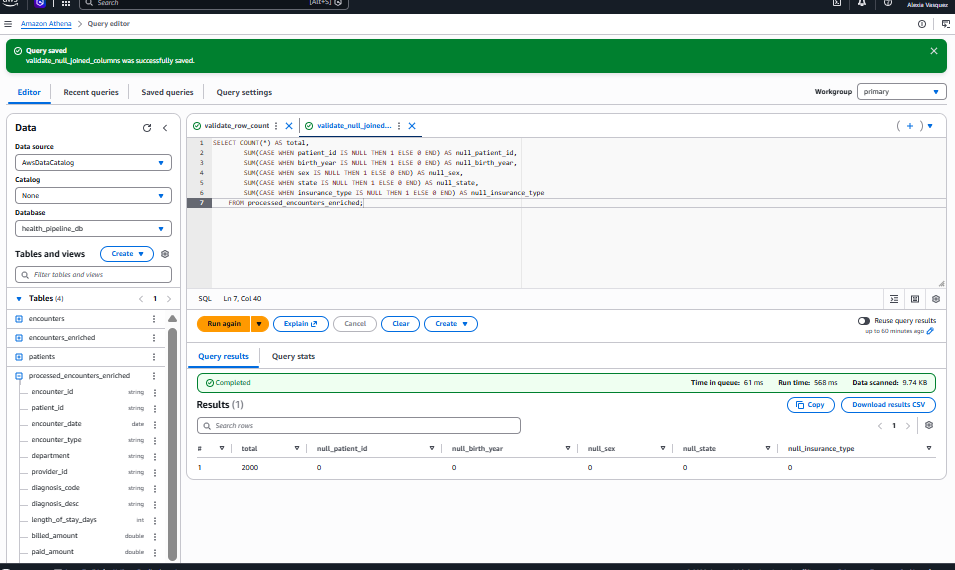

**Analysis**

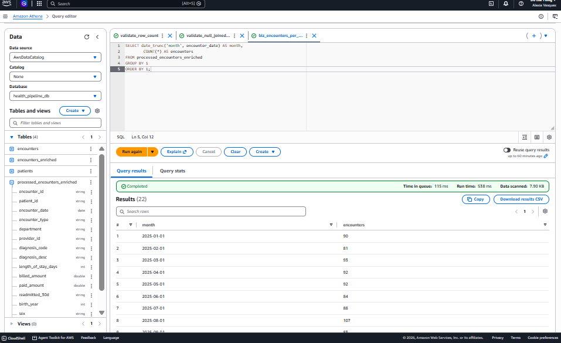
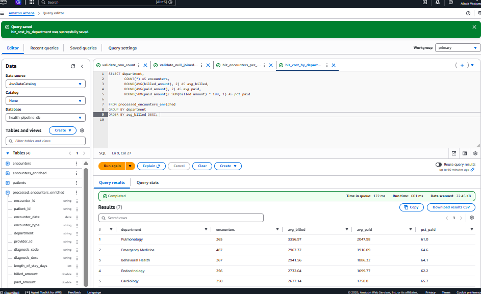
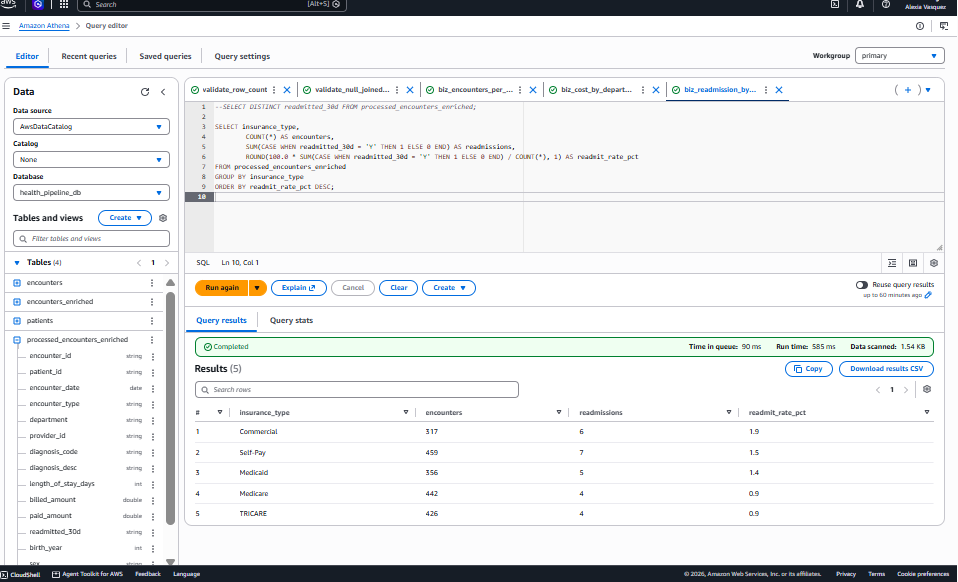

**Partitioned data in S3**

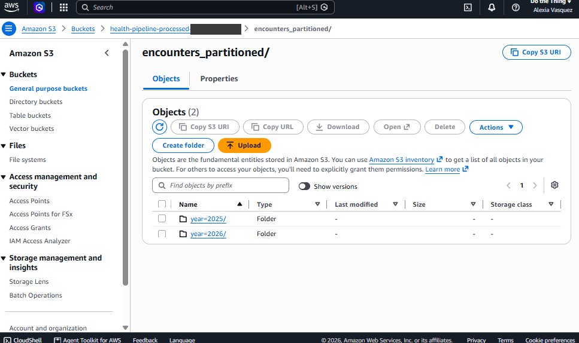
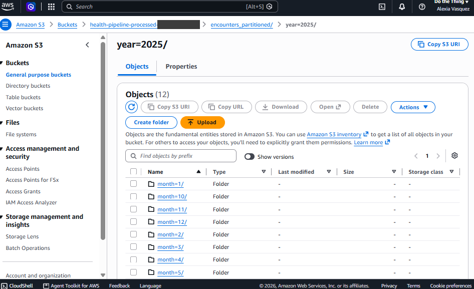
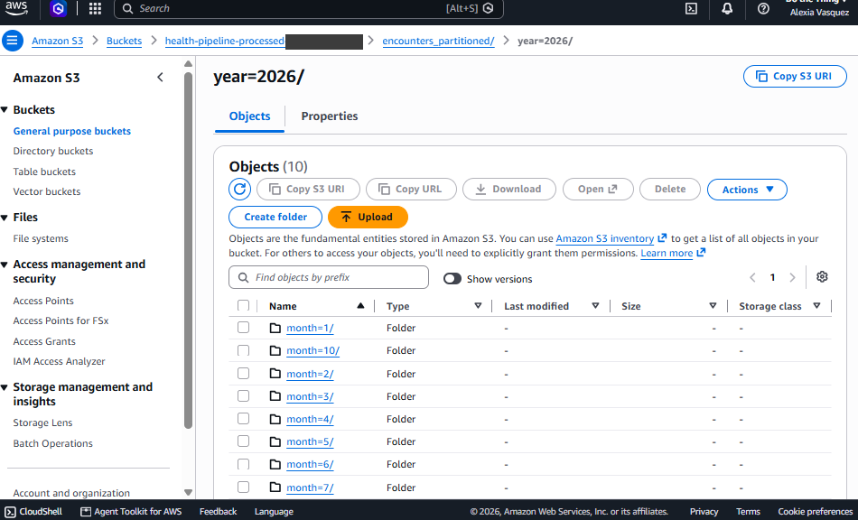

**Partition cost comparison**

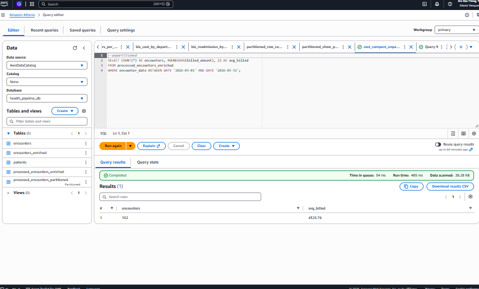
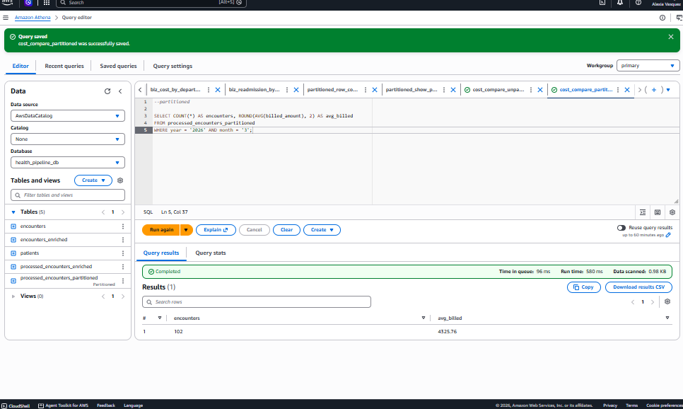

This project shows the full path from raw files to clean, queryable, cost-optimized data on AWS.

